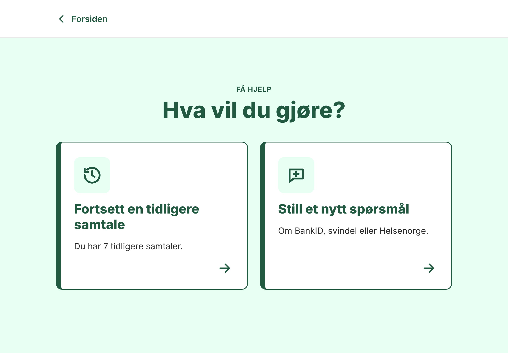
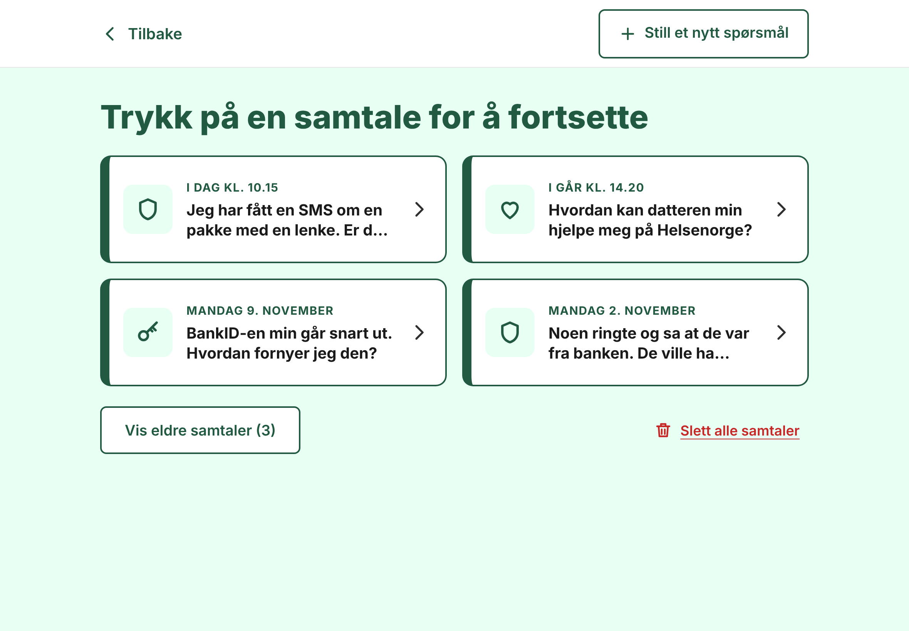
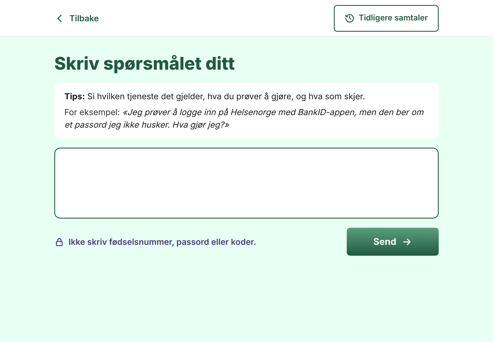
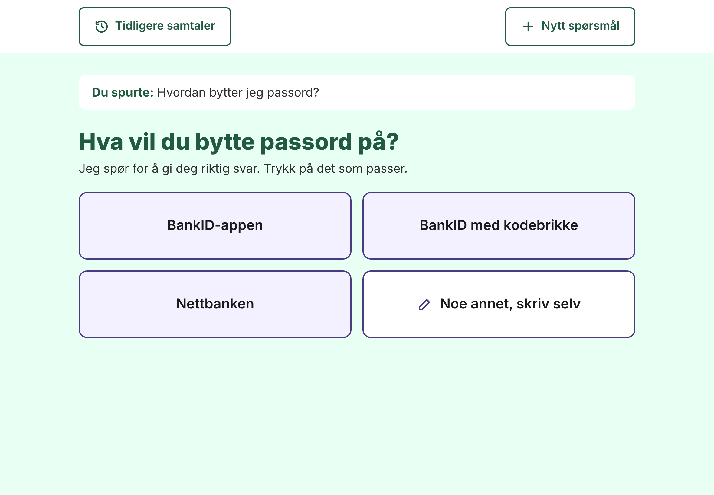
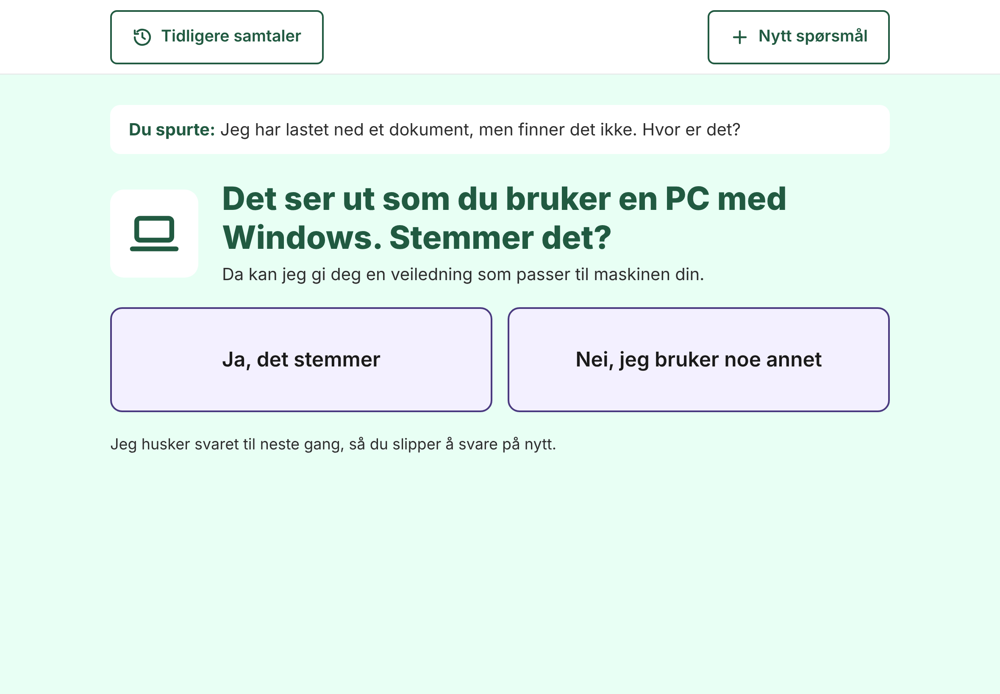
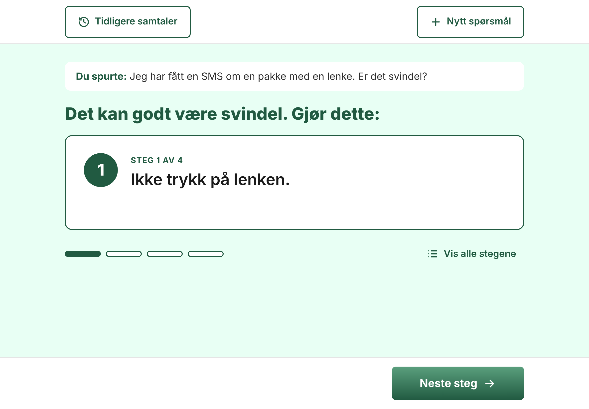
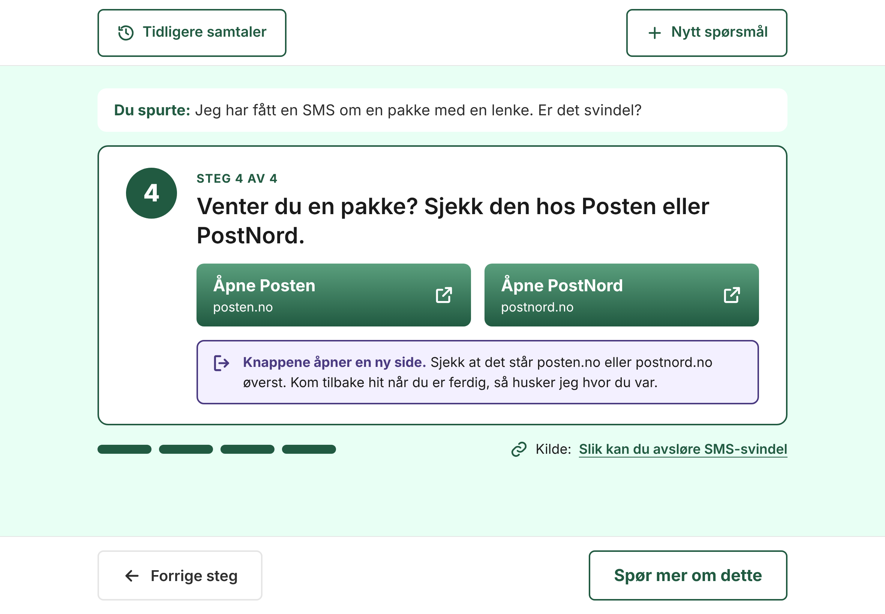
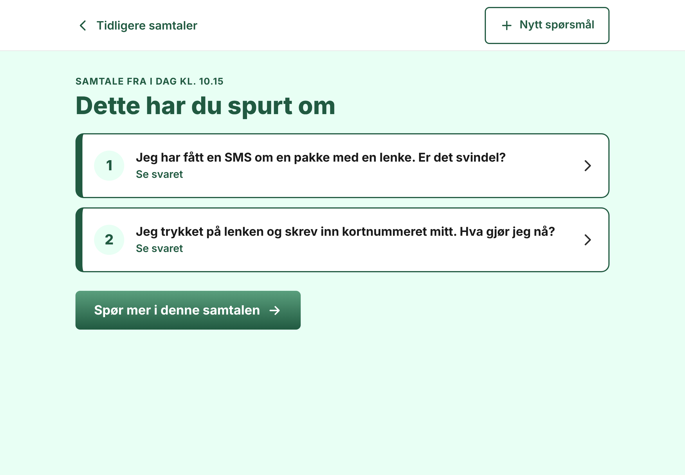

# AI chatbot for older users

> **Work in progress.** The design below is finished as a concept, and the code is being rebuilt to match it. See [Status](#status) for what works today.

A Norwegian-language assistant that creates step-by-step guides for older adults who get stuck with **BankID and login**, **scams and online safety**, and **Helsenorge**. It answers only from public guidance pages, asks follow-up questions when a question is unclear, adapts the guide to the device the user has, and shows one step at a time.

This is a practice project for learning retrieval augmented generation (RAG) end to end. It is not a product, and its answers can be wrong.

## Why a guide generator and not a chatbot

The project started as a regular chatbot with a clearer design and approved sources. Observations from helping older adults with digital services changed the concept:

- Many miss whatever is below the edge of the screen, whether it is a button or the rest of an answer.
- When a page has too much text, many give up instead of reading it.
- Earlier conversations in a side menu are not found, or the headings are not understood as conversations.
- Many do not realise when they have to leave one app and open another, and they do not recognise the symbols experienced users take for granted.
- Vague questions, such as "How do I change my password?", get poor answers.

So instead of a general chatbot, this is a customer-service-style guide generator. It is not meant for every kind of question, but it aims to be better than general chatbots at helping with concrete computer problems.

## Design

The interface is in Norwegian and designed for a tablet in landscape. Every screen fits without scrolling. The visual style is shared with the AI literacy course at [seniorki.no](https://seniorki.no), where the assistant is meant to live later as one of several features.

| | |
| --- | --- |
|  |  |
| **Start:** two large choices. Skipped on the first visit. | **Earlier conversations:** large cards with the date and the user's own question, never hidden in a side menu. |
|  |  |
| **New question:** one field, one tip with an example of a good question. | **Clarifying question:** when a question is unclear, the assistant asks back with large answer buttons. |
|  |  |
| **Device:** the app guesses the device from the browser and asks the user to confirm. | **One step at a time:** large text, progress, and the Next step button always visible. |
|  |  |
| **Link buttons and app switching:** links come only from an approved list, and steps that leave the app are marked. | **Conversation overview:** every question in a conversation as its own card. |

The screenshots show the design, not the running app.

### Design decisions

- **One step at a time.** The guide shows one step per screen, with "Show all steps" and "Print the steps" for those who want the whole guide.
- **Ask before answering.** Vague questions get a follow-up question with answer buttons instead of a guess.
- **Adapted to the device.** The same task is explained differently on an iPhone, an Android phone, a tablet, a Windows PC and a Mac.
- **Approved links only.** The model can only pick links from a list in the code, never write its own web addresses. An assistant about scams that invents URLs is exactly what must not happen.
- **Marked app switches.** Steps where the user has to leave the app say so, explain how to come back, and the app remembers which step the user was on.
- **Own symbol set.** Twelve simple, generic symbols (folder, downloads, search, settings, menu and so on), always shown next to the word. No imitations of Apple or Microsoft icons. Where possible, guides tell users to open an app by searching for its name instead of recognising its icon.
- **No hand-written guides.** All guides are generated from the sources.
- **Stored only in the browser.** Conversations, the chosen device and the current step are kept in the browser. Nothing is stored on the server.

## Status

**Working (first version, older concept, tested with an offline stand-in only):**

- Fetching, cleaning and chunking of public guidance pages
- Local vector search
- FastAPI endpoint that answers only from retrieved sources, with a guard that stops national identity numbers before they reach the model
- Evaluation script with 25 preliminary test questions
- React interface with one question and one answer, in the seniorki.no style

**In progress:** rebuilding the backend and interface to match the design above.

**Not verified yet:** fetching the real pages, calls to Azure OpenAI, answer quality, a full accessibility review, and testing with older users.

## Roadmap

- [x] Knowledge base pipeline: fetch, clean, chunk, embed, search
- [x] First API and interface (one question, one answer)
- [x] Design of the guide generator
- [ ] Run against real sources and Azure OpenAI, and tune the search
- [ ] Two answer types: clarifying question with options, or step-by-step guide
- [ ] Device and earlier questions in the conversation used in both search and prompt
- [ ] Approved link list, symbol names and app-switch markers in the guide format
- [ ] Interface following the design: start, earlier conversations, new question, clarification, device, one step at a time
- [ ] Conversations, device and current step stored in the browser, with "Delete all conversations" and "Continue where you left off"
- [ ] Accessibility review: keyboard, screen reader, contrast, large text and WAVE
- [ ] Testing with older users
- [ ] Mobile layout
- [ ] Integration in seniorki.no

## How it works

```
sources.json ──> scrape ──> chunk ──> embed ──> local index
                                                    │
question ──> embed ──> search top chunks ──> prompt with rules ──> answer + sources ──> React UI
```

1. **Collect** (`app/scrape.py`): fetches the pages listed in `backend/data/sources.json`, honours `robots.txt`, and strips menus, footers, scripts and forms.
2. **Chunk** (`app/chunk.py`): splits each page into pieces of up to about 1000 characters. Every chunk keeps the page title, nearest heading and URL.
3. **Embed** (`app/ingest.py`, `app/llm.py`): turns each chunk into a vector with an Azure OpenAI embedding model.
4. **Search** (`app/store.py`): a small local vector store using NumPy and cosine similarity.
5. **Answer** (`app/rag.py`): sends the best chunks and the question to a chat model with strict rules: answer only from the sources, use plain language, say when the answer is not there, never ask for personal data.
6. **Show** (`app/main.py`, `frontend/`): a FastAPI endpoint returns the answer as structured JSON, and a React page shows the steps and source links.

**Planned changes:** the search will combine the question with earlier questions in the conversation and the answers to follow-up questions, so that a follow-up such as "What do I do now?" still finds the right sources. The model will answer in one of two formats: a clarifying question with two to four options, or a guide where each step can carry a symbol name, a key to press, a link from the approved list and an app-switch marker.

## Tech stack

| Part | Choice |
| --- | --- |
| Language model | Azure OpenAI (one small chat model, one embedding model) |
| Backend | Python 3.11+, FastAPI |
| Vector search | Local, NumPy |
| Frontend | React, TypeScript, Vite |
| Accessibility target | WCAG 2.2 AA |
| Visual style | Shared with the AI literacy course at [seniorki.no](https://seniorki.no): same colours, typeface, buttons and cards |

## Getting started

These steps run the current first version. You need Python 3.11 or newer, Node.js 20 or newer, and an Azure OpenAI resource with one chat deployment and one embedding deployment.

### 1. Backend

```bash
cd backend
python -m venv .venv
source .venv/bin/activate        # Windows: .venv\Scripts\activate
pip install -r requirements-dev.txt
cp .env.example .env             # then fill in your Azure values
```

`.env` holds your API key and is ignored by Git. Never commit it.

Build the knowledge base (fetches the pages and creates embeddings):

```bash
python -m app.ingest
```

Pages that could not be fetched are listed as `SKIPPED` with the reason. Try the search on its own before generating answers:

```bash
python -m app.search "Jeg har glemt BankID-passordet mitt"
```

Start the API:

```bash
uvicorn app.main:app --reload
```

### 2. Frontend

```bash
cd frontend
npm install
npm run dev
```

Open http://localhost:5173.

### Running without Azure

Set `USE_FAKE_LLM=1` in `backend/.env` to use the built-in stand-in. It needs no key and costs nothing, which is useful for working on the interface. It is not a language model: it matches on shared words and repeats text from the first source.

## Tests and evaluation

```bash
cd backend
pytest                      # unit and API tests, no network or key needed
python -m app.evaluate      # runs the 25 test questions and writes a CSV
```

The evaluation writes `backend/eval/results-<time>.csv` with each answer, its sources, and empty columns to fill in by hand: is the answer correct, and is it in plain language. The script itself only checks whether the assistant answered or declined as expected.

The questions in `backend/eval/questions.json` are preliminary. They will be replaced with questions older users actually ask, plus vague questions that should trigger a follow-up question.

## Settings

| Variable | Meaning |
| --- | --- |
| `AZURE_OPENAI_ENDPOINT` | Endpoint of your Azure OpenAI resource |
| `AZURE_OPENAI_API_KEY` | API key |
| `AZURE_OPENAI_API_VERSION` | API version, default `2024-10-21` |
| `AZURE_OPENAI_CHAT_DEPLOYMENT` | Name of your chat deployment |
| `AZURE_OPENAI_EMBEDDING_DEPLOYMENT` | Name of your embedding deployment |
| `USE_FAKE_LLM` | `1` to run without Azure |
| `TOP_K` | Number of chunks sent to the model, default 4 |
| `MIN_SCORE` | Lowest similarity a chunk needs to be used, default 0.25 |

`MIN_SCORE` is a guess and must be tuned once real embeddings exist. Use `python -m app.search` to see typical scores for good and bad matches.

## Sources and content

The knowledge base is built from public guidance pages from BankID, the Norwegian police, Nkom, Nettvett and Helsenorge. The list is in `backend/data/sources.json`.

- Fetched text and the index are saved under `backend/data/raw` and `backend/data/index`. Both are ignored by Git, so no third-party content is published in this repository.
- Check each site's terms of use before fetching.
- Only four Norwegian Helsenorge pages are enabled so far. Six English Helsenorge pages are listed with `"enabled": false` as reminders to find the Norwegian pages on the same subjects (login, prescriptions, appointments, GP, app, power of attorney).

## Privacy and safety

- Questions are processed in memory and are not logged or stored on the server.
- The interface tells users not to enter personal data.
- Text that looks like a Norwegian national identity number is rejected before any call to Azure.
- Every page shows a reminder never to share BankID codes or passwords.
- In the planned version, conversations are stored only in the user's own browser and can be deleted at any time. On a shared computer, they must be deleted between users.
- Scam and BankID advice is high stakes. A wrong answer here can cost someone money, so answers must be reviewed before anyone relies on them.

## Project structure

```
backend/
  app/          scrape, chunk, llm, store, rag, ingest, search, evaluate, main (API)
  data/         sources.json (raw pages and index are created locally)
  eval/         test questions
  tests/        pytest tests
docs/
  images/       screenshots of the design
frontend/
  src/          React app (Norwegian interface)
```

## How this is built

The code in this repository is written by Claude, Anthropic's AI model, through Claude Code. Alexander Mora directs the project: the observations of older users, the concept, the design decisions and the requirements. Commits are authored by Claude, with Alexander as co-author.

When the first version is finished, Alexander will rebuild the project himself, with Claude as a tutor.
